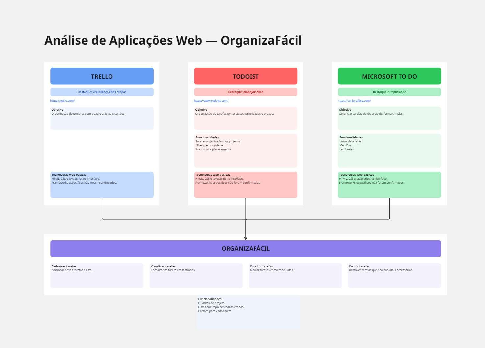

# Atividade 01 — Organização Inicial do Projeto

**Disciplina:** Programação Web  
**Professor:** Prof. Me. Deivison S. Takatu  
**Modalidade de realização:** Individual  
**Instituição:** Fatec Itapetininga

## 1. Objetivo

Iniciar a organização das atividades da disciplina de Programação Web, definir uma proposta de projeto, criar um repositório no GitHub e pesquisar tecnologias utilizadas no desenvolvimento de aplicações web.

## 2. Proposta da atividade

O enunciado apresentado pelo professor previa a formação de grupos de 3 a 5 integrantes, a definição de uma proposta de projeto e a análise de três sites utilizando o Miro.

Nesta documentação, a atividade será desenvolvida **individualmente**, mantendo os objetivos técnicos propostos.

## 3. Organização do repositório

Foi utilizado o repositório [Programacao_Web](https://github.com/Luizaaaaaah/Programacao_Web) para centralizar os resumos das aulas, os relatórios das atividades e as evidências dos trabalhos desenvolvidos durante a disciplina.

O repositório está organizado em três diretórios principais:

- `aulas/` — resumos dos conteúdos apresentados.
- `atividades/` — documentação das atividades práticas.
- `historico/` — registros de versões e documentos anteriores.

## 4. Proposta de projeto

**Nome:** OrganizaFácil — Gerenciador de Tarefas.

**Modalidade:** Individual.

**Problema identificado:** A dificuldade de organizar atividades pessoais, acadêmicas e compromissos cotidianos pode ocasionar esquecimentos e atrasos.

**Solução proposta:** Desenvolver uma aplicação web simples e intuitiva para cadastrar, visualizar, concluir e excluir tarefas.

**Público-alvo:** Estudantes e pessoas que desejam organizar suas atividades diárias.

**Funcionalidades previstas:**
- Cadastro de tarefas.
- Visualização das tarefas registradas.
- Marcação de tarefas concluídas.
- Exclusão de tarefas.
- Interface simples e responsiva.

## 5. Pesquisa e análise de três sites

Para estudar aplicações semelhantes ao OrganizaFácil, foram selecionadas três plataformas de gerenciamento de tarefas: Trello, Todoist e Microsoft To Do.

### 5.1. Trello

**Site:** https://trello.com/

**Objetivo:** Organizar projetos e tarefas por meio de quadros visuais.

**Funcionalidades principais:**
- Criação de quadros.
- Organização de tarefas em listas e cartões.
- Movimentação de cartões entre etapas.
- Definição de prazos e responsáveis.

**Características:** O Trello utiliza uma organização visual que facilita o acompanhamento das etapas de um projeto.

**Referência para o OrganizaFácil:** Apresentação clara das tarefas e identificação de seu andamento.

### 5.2. Todoist

**Site:** https://www.todoist.com/

**Objetivo:** Facilitar o planejamento de tarefas pessoais, acadêmicas e profissionais.

**Funcionalidades principais:**
- Cadastro e conclusão de tarefas.
- Organização por projetos.
- Definição de prioridades.
- Datas de vencimento e lembretes.

**Características:** O Todoist apresenta ferramentas para organizar tarefas e destacar atividades importantes.

**Referência para o OrganizaFácil:** Cadastro simples e acompanhamento de tarefas pendentes e concluídas.

### 5.3. Microsoft To Do

**Site:** https://to-do.office.com/

**Objetivo:** Auxiliar no planejamento e na organização das atividades diárias.

**Funcionalidades principais:**
- Criação de listas.
- Cadastro e conclusão de tarefas.
- Organização de atividades na seção Meu Dia.
- Inclusão de etapas e lembretes.

**Características:** A aplicação prioriza o gerenciamento de listas e o planejamento cotidiano.

**Referência para o OrganizaFácil:** Interface simples, com foco nas tarefas do usuário.

### 5.4. Comparação dos sites

| Característica | Trello | Todoist | Microsoft To Do |
|---|---|---|---|
| Organização principal | Quadros e cartões | Projetos e listas | Listas de tarefas |
| Cadastro de tarefas | Sim | Sim | Sim |
| Conclusão de tarefas | Sim | Sim | Sim |
| Prazos | Sim | Sim | Sim |
| Principal destaque | Organização visual | Prioridades e planejamento | Simplicidade |
| Inspiração para o projeto | Visualização das etapas | Gerenciamento de tarefas | Facilidade de uso |

### 5.5. Tecnologias utilizadas

As três aplicações são plataformas web acessíveis por navegadores.

Para analisar suas tecnologias, serão considerados os recursos de desenvolvimento de páginas web, como HTML, CSS e JavaScript, e ferramentas de inspeção do navegador.

A identificação de frameworks, bibliotecas e serviços específicos dependerá da inspeção técnica de cada aplicação. Não serão atribuídas tecnologias internas sem confirmação.

### 5.6. Conclusão da pesquisa

A comparação mostra diferentes maneiras de organizar tarefas.

O Trello destaca a visualização por etapas, o Todoist oferece recursos de planejamento e o Microsoft To Do apresenta uma proposta simples para atividades cotidianas.

Para o OrganizaFácil, a ideia é combinar a simplicidade das listas com funcionalidades básicas de cadastro, visualização, conclusão e exclusão de tarefas.

**Referências:**
- TRELLO. https://trello.com/
- TODOIST. https://www.todoist.com/
- MICROSOFT TO DO. https://to-do.office.com/

## 6. Representação visual no Miro

Após a pesquisa dos três sites, foi desenvolvido individualmente um quadro visual no Miro para representar suas principais características e a relação com a proposta OrganizaFácil.

O quadro apresenta:

- **Trello:** organização de tarefas por quadros, listas e cartões.
- **Todoist:** planejamento de tarefas, projetos e prioridades.
- **Microsoft To Do:** gerenciamento de listas e atividades diárias.
- **OrganizaFácil:** proposta de aplicação que reúne funcionalidades básicas de gerenciamento de tarefas.

As tecnologias fundamentais da interface web foram apresentadas no quadro, sem atribuir frameworks específicos que não foram confirmados.

**Link do quadro:** [Visualizar análise no Miro](https://miro.com/app/board/uXjVEK_PIAI=/?share_link_id=573565708268)

### Imagem do quadro

## 7. Evidências da atividade

| Evidência | Situação |
|---|---|
| Repositório no GitHub | Criado e organizado |
| Proposta individual OrganizaFácil | Documentada na seção 4 |
| Análise dos três sites | Documentada na seção 5 |
| Quadro visual no Miro | Criado |
| Imagem do quadro | Adicionada em `prints/04-board-miro.jpg` |
| Link de compartilhamento | Registrado na seção 6 |

**Repositório:** [Programacao_Web](https://github.com/Luizaaaaaah/Programacao_Web)

## 8. Situação da atividade

- [x] Repositório GitHub criado.
- [x] Resumo da Aula 01 elaborado.
- [x] Proposta individual OrganizaFácil definida.
- [x] Pesquisa comparativa de três sites documentada.
- [x] Quadro visual desenvolvido no Miro.
- [x] Imagem exportada e adicionada ao projeto.
- [x] Link do quadro registrado.
- [ ] Confirmar se o link permite visualização pelo professor.

## 9. Conclusão

A Atividade 01 foi desenvolvida individualmente, com foco na organização do repositório, na definição de uma proposta de aplicação web e na análise de plataformas existentes.

A pesquisa do Trello, Todoist e Microsoft To Do permitiu identificar diferentes formas de organização de tarefas e selecionar funcionalidades para o projeto OrganizaFácil.

A representação visual no Miro reuniu as características analisadas e demonstrou como essas referências contribuíram para a proposta do projeto.