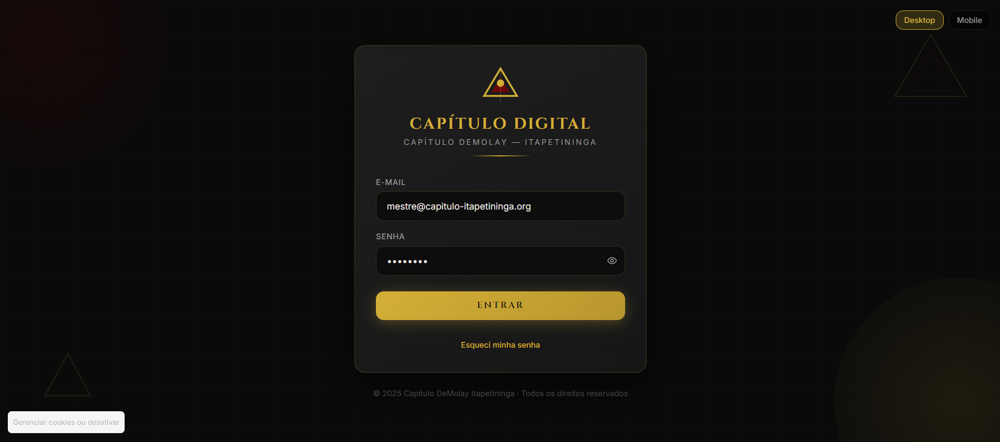
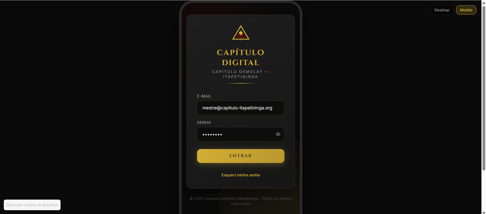

# Atividade 02 — Escopo, Prototipação e Experiência do Usuário

**Disciplina:** Programação Web  
**Professor:** Prof. Me. Deivison S. Takatu  
**Instituição:** Fatec Itapetininga  
**Projeto documentado:** Capítulo Digital  
**Modalidade:** Trabalho desenvolvido em conjunto com colegas

## 1. Objetivo

Compreender a importância do planejamento de aplicações web, abordando a definição de escopo, a análise de aplicações semelhantes, a arquitetura de navegação, a elaboração de histórias de usuário e a criação de protótipos.

A atividade também propõe a organização das tarefas por meio de um quadro Kanban.

## 2. Proposta da atividade

O professor solicitou:

- Pesquisar aplicações semelhantes e identificar seus pontos fortes e fracos.
- Descrever a arquitetura e a navegação da aplicação.
- Elaborar três histórias de usuário.
- Criar protótipos das principais telas.
- Organizar as tarefas no Trello utilizando o método Kanban.
- Documentar as etapas desenvolvidas.

## 3. Projeto utilizado — Capítulo Digital

Para esta documentação, foi reaproveitado o protótipo **Capítulo Digital**, disponibilizado no repositório do colega Rafael.

O protótipo apresenta uma interface de acesso identificada como **Capítulo DeMolay — Itapetininga**.

A tela inicial contém campos de e-mail e senha, botão para entrar, opção de visualizar a senha e acesso à recuperação de senha.

O projeto possui identidade visual própria, utilizando fundo escuro, elementos dourados e um formulário centralizado.

**Repositório de referência:** [Prototipo_figma](https://github.com/RafaelRachidd/Prototipo_figma)

**Protótipo interativo:** [Visualizar no Figma](https://www.figma.com/make/ZsdN3hUiXFukSSZMdaGK0v/Cap%C3%ADtulo-Digital-Prototype-Design?t=d5yGHqT4EeRnPp9q-1)

**Observação:** O Capítulo Digital é um projeto diferente do OrganizaFácil, utilizado como proposta individual na Atividade 01. Aqui foi documentado o protótipo existente desenvolvido no contexto das atividades da disciplina.

## 4. Análise de aplicações semelhantes

Para compreender soluções utilizadas na administração de organizações e associações, foram pesquisadas três plataformas: WildApricot, Join It e ClubExpress.

A pesquisa foi realizada por meio das informações disponibilizadas nos sites oficiais das ferramentas, observando suas funcionalidades, pontos fortes, limitações e possíveis contribuições para o projeto Capítulo Digital.

### 4.1. WildApricot

**Site:** https://www.wildapricot.com/

**Objetivo:** Auxiliar associações, clubes e organizações no gerenciamento de membros, eventos e pagamentos.

**Funcionalidades principais:**
- Cadastro e gerenciamento de membros.
- Controle de pagamentos e renovações.
- Organização de eventos.
- Comunicação com associados.
- Relatórios administrativos.

**Pontos fortes:** Centralização das informações e integração de recursos administrativos em uma mesma plataforma.

**Possível limitação para o projeto:** Por ser uma solução genérica para diferentes organizações, pode exigir adaptações para representar as regras específicas de um Capítulo DeMolay.

**Contribuição para o Capítulo Digital:** Referência para o gerenciamento de membros, pagamentos e informações administrativas.

### 4.2. Join It

**Site:** https://joinit.com/

**Objetivo:** Simplificar o gerenciamento de associados e das atividades de organizações.

**Funcionalidades principais:**
- Banco de dados de membros.
- Gerenciamento de pagamentos.
- Renovação de associações.
- Inscrição em eventos.
- Portal para consulta de informações pelos associados.

**Pontos fortes:** Organização centralizada dos membros e ferramentas voltadas para a administração de associações.

**Possível limitação para o projeto:** A aplicação não foi desenvolvida especificamente para os processos administrativos de um Capítulo DeMolay.

**Contribuição para o Capítulo Digital:** Inspiração para o cadastro de membros, controle de situação cadastral e organização dos dados.

### 4.3. ClubExpress

**Site:** https://www.clubexpress.com/

**Objetivo:** Oferecer ferramentas para administração de clubes, associações e organizações com diferentes estruturas de membros.

**Funcionalidades principais:**
- Cadastro e gerenciamento de associados.
- Organização por capítulos ou grupos.
- Gerenciamento de eventos.
- Controle de pagamentos.
- Relatórios e administração financeira.
- Diferentes níveis de acesso administrativo.

**Pontos fortes:** Recursos direcionados à gestão de organizações e possibilidade de administração por grupos ou capítulos.

**Possível limitação para o projeto:** A quantidade de recursos disponíveis pode tornar a plataforma mais complexa do que o necessário para uma solução específica.

**Contribuição para o Capítulo Digital:** Referência para organização de membros, perfis de acesso, gestão financeira e estrutura administrativa.

### 4.4. Comparação das aplicações

| Característica | WildApricot | Join It | ClubExpress |
|---|---|---|---|
| Gestão de membros | Sim | Sim | Sim |
| Gestão de pagamentos | Sim | Sim | Sim |
| Organização de eventos | Sim | Sim | Sim |
| Administração de capítulos ou grupos | Recursos de grupos | Recursos para organizações com capítulos | Recursos específicos para capítulos |
| Principal destaque | Gestão administrativa integrada | Centralização de associados | Gestão de clubes e capítulos |
| Referência para o projeto | Membros e pagamentos | Cadastro e organização | Perfis e gestão administrativa |

### 4.5. Conclusão da pesquisa

A análise permitiu identificar funcionalidades importantes para sistemas de gerenciamento de organizações.

As três ferramentas oferecem soluções para organizar informações e facilitar tarefas administrativas.

Para o Capítulo Digital, destacam-se como referências o gerenciamento de membros, o controle financeiro, a organização das informações e a definição de permissões de acesso.

As limitações apresentadas são avaliações de adequação ao projeto proposto, não resultados de testes práticos nas plataformas.

**Referências:**
- WILDAPRICOT. https://www.wildapricot.com/features
- JOIN IT. https://joinit.com/features
- CLUBEXPRESS. https://www.clubexpress.com/tour

## 5. Arquitetura e navegação

O planejamento do Capítulo Digital contempla funcionalidades relacionadas à administração de membros, controle financeiro, inventário e gerenciamento das informações do capítulo.

Com base nas atividades registradas no Trello, foi elaborado um sitemap conceitual para representar como as principais áreas poderiam ser organizadas.

### 5.1. Sitemap proposto

```text
CAPÍTULO DIGITAL
│
├── Tela de Login
│   ├── E-mail
│   ├── Senha
│   └── Recuperação de senha
│
└── Área Administrativa
    │
    ├── Painel Principal
    │
    ├── Gestão de Membros
    │   ├── Listagem de membros
    │   ├── Cadastro de membros
    │   └── Dados dos membros
    │
    ├── Tesouraria
    │   ├── Controle financeiro
    │   ├── Pagamentos
    │   └── Relatórios financeiros
    │
    ├── Inventário
    │   ├── Listagem de itens
    │   └── Cadastro de itens
    │
    └── Administração
        ├── Perfis de usuários
        └── Permissões de acesso
```

**Observação:** O sitemap representa uma proposta de navegação baseada no planejamento do projeto. A tela de login foi observada no Figma, mas as demais telas e rotas ainda não foram verificadas no protótipo.

### 5.2. Componentes principais

**Interface de acesso:** responsável pela apresentação dos campos de login e das opções de autenticação.

**Painel principal:** área prevista para centralizar a navegação entre os módulos administrativos.

**Gestão de membros:** módulo proposto para cadastro, consulta e organização das informações dos integrantes.

**Tesouraria:** módulo previsto para gerenciamento de informações financeiras.

**Inventário:** área planejada para controle dos itens e materiais do capítulo.

**Administração:** módulo previsto para gerenciamento dos perfis de usuários e permissões.

### 5.3. Arquitetura técnica planejada

O quadro Trello contém tarefas relacionadas ao desenvolvimento de uma API REST com Node.js e de uma interface web com React.js.

A integração entre essas partes pode ser representada conceitualmente como:

**Usuário → Interface Web → API REST → Armazenamento de Dados**

Essa representação corresponde ao planejamento técnico e não comprova que todos os componentes estejam implementados.

### 5.4. Experiência de navegação

A organização proposta busca permitir que usuários autorizados acessem as funcionalidades correspondentes às suas responsabilidades.

O objetivo é manter uma navegação clara, agrupando recursos administrativos por finalidade e evitando que as informações fiquem dispersas entre diferentes ferramentas.

O protótipo de login no Figma constitui a referência visual inicial para essa proposta.

## 6. Histórias de usuário

Com base na interface observada, foram propostas três histórias de usuário para orientar os requisitos do sistema.

### História 01 — Autenticação

**Como** usuário autorizado,  
**quero** informar meu e-mail e minha senha,  
**para** acessar o sistema Capítulo Digital.

### História 02 — Recuperação de acesso

**Como** usuário que esqueceu sua senha,  
**quero** encontrar uma opção de recuperação,  
**para** tentar recuperar o acesso à minha conta.

### História 03 — Visualização da senha

**Como** usuário que está preenchendo o formulário de login,  
**quero** poder visualizar temporariamente a senha digitada,  
**para** conferir se informei os caracteres corretamente.

Essas histórias foram formuladas a partir dos elementos visíveis no protótipo. Não representam confirmação de que as funcionalidades de autenticação e recuperação estejam implementadas.

## 7. Prototipação no Figma

O protótipo foi disponibilizado por meio do Figma e apresenta visualizações para desktop e dispositivos móveis.

### 7.1. Visualização desktop

Na versão desktop, o formulário aparece centralizado na página.

A interface utiliza fundo escuro, bordas e elementos dourados, campos de entrada e um botão de destaque para a ação principal.



### 7.2. Visualização mobile

A visualização mobile mantém os elementos principais do formulário, adaptando a apresentação à largura de uma tela de celular.

O título passa a ocupar duas linhas e os campos de entrada permanecem organizados verticalmente.



### 7.3. Experiência do usuário

Entre os aspectos observados na interface, destacam-se:

- Identidade visual consistente.
- Destaque para o botão principal.
- Identificação dos campos do formulário.
- Opção de visualizar a senha.
- Link de recuperação de acesso.
- Adaptação visual entre desktop e mobile.

A análise foi realizada com base nas telas apresentadas. Não foram comprovados testes completos de funcionamento, acessibilidade ou autenticação.


## 8. Organização das atividades com Kanban

As atividades do projeto Capítulo Digital foram organizadas em um quadro no Trello, combinando planejamento por Sprints com acompanhamento do andamento das tarefas.

**Quadro:** [Projeto Capítulo Digital DeMolay](https://trello.com/b/6wQJ2B7i/projeto-capitulo-digital-demolay)

O quadro possui oito listas: Backlog, Sprint 1, Sprint 2, Sprint 3, Sprint 4, Em desenvolvimento, Em testes e Concluído.

Na consulta realizada, foram identificados 33 cartões distribuídos entre essas listas.

Entre as tarefas registradas estão:
- Levantamento de requisitos funcionais e não funcionais.
- Definição da arquitetura de alto nível.
- Definição das regras de negócio.
- Desenvolvimento da API REST em Node.js.
- Implementação do front-end em React.js.
- Testes de autenticação e segurança.
- Testes de usabilidade.
- Documentação inicial e organização do GitHub.

A lista "Concluído" contém oito cartões, enquanto as demais listas registram atividades planejadas ou em diferentes etapas.

O quadro foi utilizado como evidência da organização e do planejamento do projeto.


## 9. Evidências da atividade

| Evidência | Situação |
|---|---|
| Protótipo no Figma | Localizado e vinculado |
| Repositório do protótipo | Localizado no GitHub do Rafael |
| Tela desktop | Imagem adicionada |
| Tela mobile | Imagem adicionada |
| Histórias de usuário | Três histórias propostas e documentadas |
| Pesquisa de aplicações semelhantes | Pesquisa documental de três plataformas concluída |
| Sitemap completo | Proposta conceitual documentada; validação das telas pendente |
| Quadro Trello | Localizado e conferido |
| Organização das tarefas | 33 cartões distribuídos em 8 listas |
| Planejamento por Sprints | Registrado no Trello |

### Links das evidências

**Protótipo no Figma:**  
[Visualizar Capítulo Digital](https://www.figma.com/make/ZsdN3hUiXFukSSZMdaGK0v/Cap%C3%ADtulo-Digital-Prototype-Design?t=d5yGHqT4EeRnPp9q-1)

**Repositório do protótipo:**  
[Prototipo_figma](https://github.com/RafaelRachidd/Prototipo_figma)

**Quadro Kanban:**  
[Projeto Capítulo Digital DeMolay — Trello](https://trello.com/b/6wQJ2B7i/projeto-capitulo-digital-demolay)

### Capturas de tela

**Protótipo desktop:**


**Protótipo mobile:**


## 10. Conclusão

A atividade permitiu estudar a relação entre planejamento, prototipação e experiência do usuário no desenvolvimento de aplicações web.

O protótipo Capítulo Digital demonstra uma proposta de interface de autenticação com identidade visual definida e adaptação para desktop e dispositivos móveis.

O material existente foi reaproveitado como registro da etapa de prototipação. A pesquisa comparativa de aplicações, a arquitetura completa e a organização no Trello ainda precisam ser verificadas ou complementadas para atender integralmente ao enunciado.