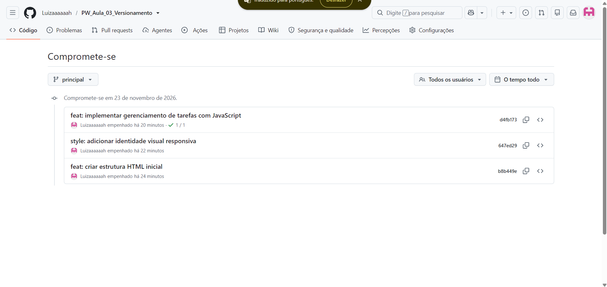
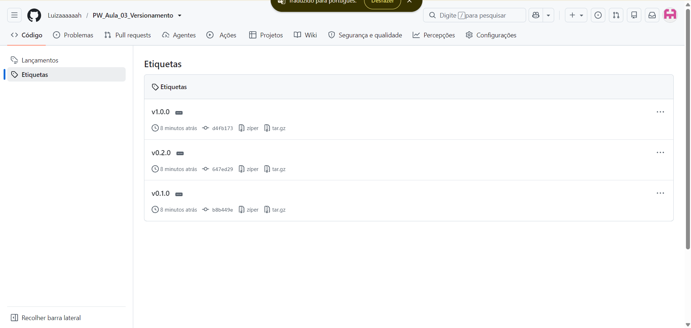
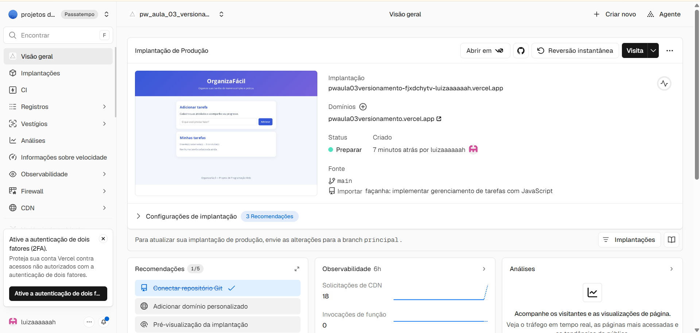
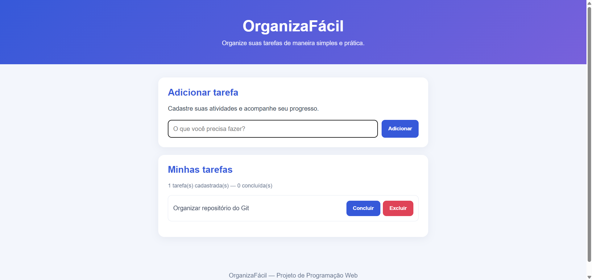

# Atividade 03 — Versionamento e Deploy

**Disciplina:** Programação Web  
**Professor:** Prof. Me. Deivison S. Takatu  
**Instituição:** Fatec Itapetininga  
**Modalidade:** Individual

## 1. Objetivo

Aplicar os conceitos de versionamento de código e publicação de aplicações web, utilizando Git, GitHub e Vercel.

A atividade envolveu a criação de uma página web, o registro de alterações por meio de commits, o controle de versões com tags e a realização de deploy.

## 2. Projeto desenvolvido

**Nome:** OrganizaFácil — Gerenciador de Tarefas

O OrganizaFácil é uma aplicação web que permite ao usuário organizar suas atividades cotidianas por meio de uma lista de tarefas.

O projeto foi desenvolvido utilizando HTML, CSS e JavaScript, sem a necessidade de frameworks.

### Funcionalidades

- Cadastrar novas tarefas.
- Visualizar tarefas cadastradas.
- Marcar tarefas como concluídas.
- Desfazer a conclusão de uma tarefa.
- Excluir tarefas.
- Visualizar a quantidade de tarefas cadastradas e concluídas.
- Manter as tarefas armazenadas no navegador por meio do localStorage.
- Utilizar a interface em computadores e dispositivos móveis.

## 3. Tecnologias utilizadas

| Tecnologia | Finalidade |
|---|---|
| HTML5 | Estrutura da aplicação |
| CSS3 | Estilização e responsividade |
| JavaScript | Funcionalidades interativas |
| localStorage | Armazenamento local das tarefas |
| Git | Controle de versões |
| GitHub | Hospedagem e histórico do código |
| Vercel | Publicação da aplicação |

## 4. Desenvolvimento

O projeto foi desenvolvido em três etapas, permitindo acompanhar sua evolução no histórico do Git.

### Etapa 1 — Estrutura HTML

Foi criado o arquivo `index.html`, contendo a estrutura inicial da aplicação, incluindo cabeçalho, formulário de tarefas, área de listagem e rodapé.

### Etapa 2 — Estilização CSS

Foi criado o arquivo `style.css`, responsável pela identidade visual do projeto.

A interface utiliza tons de azul e roxo, cartões brancos, cantos arredondados e organização responsiva.

### Etapa 3 — Funcionalidades JavaScript

Foi criado o arquivo `script.js`, responsável pelas funcionalidades de cadastro, conclusão, exclusão e armazenamento de tarefas.

O armazenamento local permite preservar os dados entre atualizações da página no mesmo navegador.

## 5. Versionamento com Git

Durante o desenvolvimento, foram registrados três commits principais:

| Commit | Descrição |
|---|---|
| `b8b449e` | feat: criar estrutura HTML inicial |
| `647ed29` | style: adicionar identidade visual responsiva |
| `d4fb173` | feat: implementar gerenciamento de tarefas com JavaScript |

### Tags criadas

| Versão | Descrição |
|---|---|
| `v0.1.0` | Primeira estrutura HTML |
| `v0.2.0` | Estilização CSS responsiva |
| `v1.0.0` | Aplicação com funcionalidades JavaScript |

As três tags foram criadas como tags anotadas e enviadas ao GitHub.

**Histórico de versões:** [Visualizar tags no GitHub](https://github.com/Luizaaaaaah/PW_Aula_03_Versionamento/tags)

## 6. Publicação no GitHub

O projeto foi disponibilizado em um repositório público, mantendo o histórico dos commits e as versões desenvolvidas.

**Repositório:** [PW_Aula_03_Versionamento](https://github.com/Luizaaaaaah/PW_Aula_03_Versionamento)

### Arquivos principais

- `index.html` — estrutura HTML.
- `style.css` — identidade visual e responsividade.
- `script.js` — gerenciamento das tarefas.

## 7. Deploy na Vercel

Para disponibilizar o projeto na web, foi utilizada a plataforma Vercel, conectada ao repositório do GitHub.

Como a aplicação utiliza HTML, CSS e JavaScript, foi configurada como um projeto sem framework específico.

**Endereço da aplicação:** [Abrir OrganizaFácil](https://pwaula03versionamento.vercel.app/)

## 8. Testes

Durante o desenvolvimento local, foram observados o carregamento da interface, a aplicação dos estilos e o cadastro de tarefas.

Para validar completamente a versão publicada, devem ser conferidas as seguintes operações:

- [ ] Abrir o site publicado em uma janela anônima.
- [ ] Cadastrar uma tarefa.
- [ ] Concluir uma tarefa.
- [ ] Desfazer a conclusão.
- [ ] Excluir uma tarefa.
- [ ] Atualizar a página e verificar o armazenamento local.
- [ ] Verificar a apresentação em uma tela menor.

## 9. Evidências da atividade

| Evidência | Situação |
|---|---|
| Projeto HTML inicial | Criado |
| Estilização CSS | Implementada |
| Funcionalidades JavaScript | Implementadas |
| Repositório GitHub | Publicado |
| Histórico de três commits | Confirmado |
| Três tags de versão | Publicadas |
| Deploy na Vercel | Realizado |
| Captura do histórico de commits | Adicionada |
| Captura das tags do GitHub | Adicionada |
| Captura do painel Vercel | Adicionada |
| Captura do site publicado | Adicionada |

### Capturas de tela

**Histórico de commits**

**Tags de versionamento**

**Deploy na Vercel**

**Aplicação publicada**

## 10. Conclusão

A atividade permitiu compreender a importância do controle de versões durante o desenvolvimento de aplicações web.

Por meio do Git, foi possível registrar as etapas do projeto e identificar diferentes versões do código.

O GitHub foi utilizado para centralizar o repositório e disponibilizar o histórico de desenvolvimento, enquanto a Vercel foi escolhida para a publicação da aplicação.

O OrganizaFácil demonstra a integração entre HTML, CSS e JavaScript e apresenta funcionalidades básicas de gerenciamento de tarefas.