# Atividade 06 — Projetos front-end em React, Angular e Vue

**Disciplina:** Programação Web  
**Professor:** Prof. Me. Deivison S. Takatu  
**Instituição:** Fatec Itapetininga

## 1. Objetivo e proposta da aula

A atividade propôs criar três projetos independentes utilizando **React**, **Angular** e **Vue**, modificar os projetos iniciais, importar e personalizar um template em um quarto repositório, publicar os quatro projetos na **Vercel** e documentar o processo com links e capturas.

Este relatório aproveita o código existente nos repositórios já desenvolvidos, distinguindo as implementações confirmadas das etapas ainda não comprovadas.

## 2. Repositórios relacionados

| Papel na atividade | Repositório | Situação observada |
|---|---|---|
| Projeto React | [exercicio_react](https://github.com/Luizaaaaaah/exercicio_react) | Aplicação com cinco funcionalidades, também documentada na Aula 05; confirmar seu reaproveitamento nesta aula |
| Projeto Angular | [exercicio_angular](https://github.com/Luizaaaaaah/exercicio_angular) | Código Angular identificado e analisado |
| Projeto Vue básico | [exercicio_vue](https://github.com/Luizaaaaaah/exercicio_vue) | Organizador de Estudos em Vue 3 criado como complementação em 24/11/2026; execução no navegador ainda pendente; deploy Vercel `READY` confirmado |
| Projeto Vue personalizado | [vue-project](https://github.com/Luizaaaaaah/vue-project) | HoennDex desenvolvida em Vue com pesquisa, filtros e design próprio |

**Trabalho em conjunto:** também foi encontrado o repositório [pokedex_vue, do Rafael](https://github.com/RafaelRachidd/pokedex_vue), com código Vue. Esse material pode ser consultado como referência do trabalho compartilhado, sem atribuir a ele automaticamente o papel de quarto projeto ou de template utilizado.

## 3. Projeto Angular — Mini Jogos

**Repositório:** [exercicio_angular](https://github.com/Luizaaaaaah/exercicio_angular)

A aplicação está organizada em um componente Angular com lógica no arquivo [src/app/app.ts](https://github.com/Luizaaaaaah/exercicio_angular/blob/main/src/app/app.ts), estrutura no arquivo [src/app/app.html](https://github.com/Luizaaaaaah/exercicio_angular/blob/main/src/app/app.html) e estilos em [src/app/app.css](https://github.com/Luizaaaaaah/exercicio_angular/blob/main/src/app/app.css).

### 3.1. Funcionalidades

| Funcionalidade | Funcionamento identificado no código |
|---|---|
| Contador | Incrementa, decrementa sem permitir valores negativos e reinicia em zero |
| Dado | Sorteia um número inteiro de 1 a 6 |
| Adivinhe o número | Gera um número de 1 a 50, recebe palpites, informa se o usuário deve tentar um valor maior ou menor e conta tentativas |

O projeto utiliza **TypeScript**, **Angular**, **CommonModule** e **FormsModule**. No template, são usados eventos de clique, interpolação, diretivas condicionais e associação de formulário com **ngModel**.

### 3.2. Estilização

A interface apresenta cartões em fundo claro, números destacados, botões azul-índigo e campos arredondados. As regras de CSS definem um conteúdo centralizado com largura máxima de 500 px e disposição flexível para os botões.

### 3.3. Execução prevista

Após clonar o repositório e instalar as dependências:

~~~bash
npm install
npm start
~~~

O comando de compilação previsto em **package.json** é **npm run build**. Esta conferência analisou o código, mas não executou o aplicativo no navegador.

## 4. Projeto Vue — HoennDex

**Repositório:** [vue-project](https://github.com/Luizaaaaaah/vue-project)

O arquivo [src/App.vue](https://github.com/Luizaaaaaah/vue-project/blob/main/src/App.vue) apresenta uma aplicação temática da região de Hoenn com:

- Cabeçalho e navegação para Início, Pokédex e Sobre Hoenn;
- Destaque visual de apresentação;
- Catálogo com nove Pokémon cadastrados diretamente no código;
- Filtro por nome e por tipo;
- Exibição de imagem, número, tipos e atributos de HP, ataque e defesa;
- Seção informativa sobre a região de Hoenn.

### 4.1. Recursos Vue utilizados

| Recurso | Aplicação |
|---|---|
| Vue 3 | Estrutura e atualização da interface |
| TypeScript | Definição do formato dos dados dos Pokémon |
| script setup | Organização da lógica do componente |
| ref | Estados de pesquisa e de filtro |
| computed | Lista de Pokémon filtrados |
| v-model | Vinculação dos filtros aos campos |
| v-for | Geração dos cartões e tipos |
| Vite | Ambiente de desenvolvimento e build |

As imagens são referenciadas por endereços do repositório público de sprites da PokeAPI; os dados dos nove Pokémon presentes no catálogo estão declarados localmente no componente. **Não foi identificada uma consulta dinâmica à API para carregar os Pokémon.**

### 4.2. Identidade visual e responsividade

A HoennDex utiliza vermelho no cabeçalho e nos detalhes, cartões claros, imagens dos Pokémon e blocos de apresentação. Em larguras de até 800 px, o código CSS altera a disposição do destaque, dos filtros e da seção informativa, além de ocultar a navegação do cabeçalho.

### 4.3. Execução prevista

~~~bash
npm install
npm run dev
~~~

Para compilação de produção, o projeto define **npm run build**. Ainda é necessário registrar uma execução real e o link de publicação.

### 4.4. Projeto Vue básico — Organizador de Estudos

O repositório [exercicio_vue](https://github.com/Luizaaaaaah/exercicio_vue), inicialmente vazio, recebeu em **24/11/2026** uma implementação complementar em Vue 3 e Vite, separada da HoennDex.

A aplicação chamada **Organizador de Estudos** permite cadastrar tarefas acadêmicas, escolher prioridades, marcar atividades concluídas, excluir itens, filtrar a lista e armazenar dados no **localStorage**.

O código utiliza os recursos **ref**, **computed**, **watch**, **v-model** e **v-for**, além de estilos responsivos. Os arquivos principais são [src/App.vue](https://github.com/Luizaaaaaah/exercicio_vue/blob/main/src/App.vue) e [src/style.css](https://github.com/Luizaaaaaah/exercicio_vue/blob/main/src/style.css).

Este projeto foi criado para completar a prática e **não é apresentado como entrega originalmente produzida na data da aula**. Seu deploy foi criado na Vercel e recebeu status `READY`; suas principais funcionalidades já foram validadas no navegador por prints, conforme a seção de testes.

## 5. Projeto React

O projeto [exercicio_react](https://github.com/Luizaaaaaah/exercicio_react) utiliza React e contém **To-Do List, contador de cliques, jogo da velha, calculadora e buscador de CEP**.

A implementação completa está descrita no [relatório da Atividade 05](../aula-05/README.md). Como o mesmo repositório foi utilizado nessa atividade anterior, seu vínculo como o primeiro projeto da Aula 06 precisa ser confirmado, sem duplicar artificialmente a autoria ou a entrega.

## 6. Importação e personalização de template

O enunciado pede um quarto repositório derivado de um template pesquisado e personalizado.

A aplicação HoennDex possui estrutura e personalizações identificáveis no código, mas **não foi localizado o endereço do template original, o procedimento de importação nem uma comparação antes/depois**. Portanto, não é possível afirmar que todas as exigências da importação foram comprovadas apenas pelo código final.

O repositório **exercicio_vue** estava vazio na conferência original e recebeu posteriormente uma implementação básica própria, o **Organizador de Estudos**, em 24/11/2026. A HoennDex continua sendo um projeto Vue distinto; a fonte do template importado ainda precisa ser confirmada.

## 7. Publicação e entrega

| Projeto | Código | URL de produção |
|---|---|---|
| React | [exercicio_react](https://github.com/Luizaaaaaah/exercicio_react) | [exercicio-react-ecru.vercel.app](https://exercicio-react-ecru.vercel.app) — `READY` |
| Angular | [exercicio_angular](https://github.com/Luizaaaaaah/exercicio_angular) | [exercicioangular.vercel.app](https://exercicioangular.vercel.app) — `READY` |
| Vue básico | [exercicio_vue](https://github.com/Luizaaaaaah/exercicio_vue) — complementação em 24/11/2026 | [exercicio-vue-fawn.vercel.app](https://exercicio-vue-fawn.vercel.app) — `READY` |
| Vue personalizado | [vue-project](https://github.com/Luizaaaaaah/vue-project) | [vue-project-alpha-peach.vercel.app](https://vue-project-alpha-peach.vercel.app) — `READY` |

Os quatro links foram obtidos diretamente da conta Vercel conectada. Os deploys aparecem com estado `READY`. **Vue básico e Angular tiveram suas principais funcionalidades validadas por prints enviados pela estudante**; os demais projetos ainda precisam de teste no navegador, assim como o acesso por terceiros e a origem do template.

## 8. Evidências

Capturas reais a incluir na pasta [prints](prints/README.md):

| Arquivo | Evidência |
|---|---|
| 01-projeto-react.png | Aplicação React |
| 02-projeto-angular.png | Mini Jogos em Angular |
| 03-projeto-vue.png | Projeto Vue de base, quando recuperado |
| 04-template-original.png | Template antes da personalização |
| 05-template-personalizado.png | HoennDex personalizada |
| 06-quatro-repositorios.png | Quatro repositórios utilizados |
| 07-quatro-deploys.png | Quatro endereços Vercel confirmados |

## 9. Validação manual do Vue básico — 24/11/2026

A página **Organizador de Estudos** foi aberta pela URL publicada na Vercel e a estudante apresentou capturas reais da interface durante a verificação.

| Teste | Resultado observado |
|---|---|
| Abertura da página | Título, formulário, indicadores e filtros exibidos corretamente |
| Cadastro de tarefa | Foi criada a tarefa **Revisar componentes Vue** com prioridade **Alta** |
| Contadores após cadastro | Total: **1**, pendentes: **1**, concluídas: **0** |
| Conclusão da tarefa | Checkbox marcado, texto riscado e contadores atualizados |
| Filtro de concluídas | Ao selecionar **Concluídas**, a tarefa finalizada permaneceu visível, com o filtro ativo e contadores coerentes |
| Filtro de pendentes | Ao selecionar **Pendentes**, a lista mostrou mensagem de nenhuma tarefa; contadores mantidos em total **1**, pendentes **0**, concluídas **1** |
| Persistência após atualização | Após o teste solicitado com **F5**, a captura apresentada mostra a tarefa **Revisar componentes Vue** ainda concluída, com prioridade **Alta** e contadores em **1/0/1**, compatível com dados preservados no localStorage |
| Exclusão de tarefa | Após clicar em **Excluir**, a tarefa deixou de aparecer e os indicadores voltaram a total **0**, pendentes **0**, concluídas **0** |
| Contadores após conclusão | Total: **1**, pendentes: **0**, concluídas: **1** |

**Resultados:** os sete passos apresentados foram aprovados a partir das capturas reais enviadas pela estudante nesta conversa. A interface visual e os contadores estavam coerentes com a implementação do código.

**Evidências:** as sete capturas reais foram anexadas à pasta [prints](prints/) da branch `reorganizacao` e são exibidas abaixo. A verificação em telas menores ainda está pendente.

### Capturas dos testes realizados

**1. Página inicial do Organizador de Estudos**

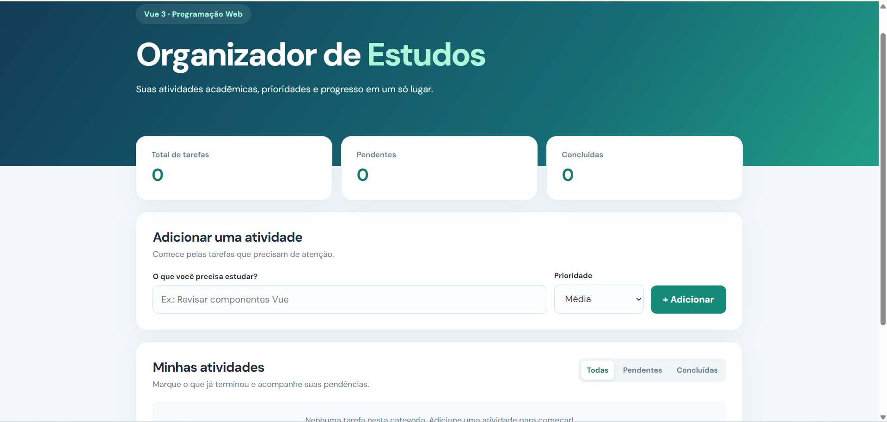

**2. Cadastro de tarefa com prioridade alta**

**3. Tarefa concluída e contadores atualizados**

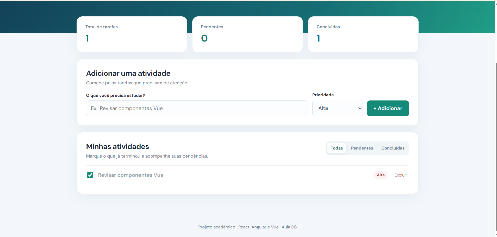

**4. Filtro de tarefas concluídas**

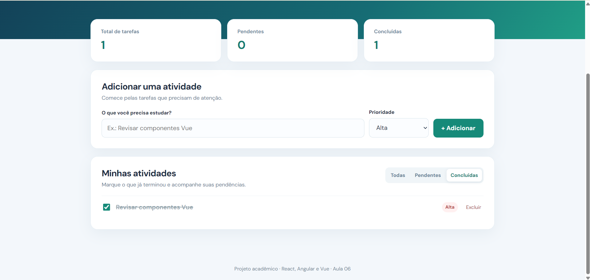

**5. Filtro de tarefas pendentes**

**6. Persistência da tarefa após atualizar**

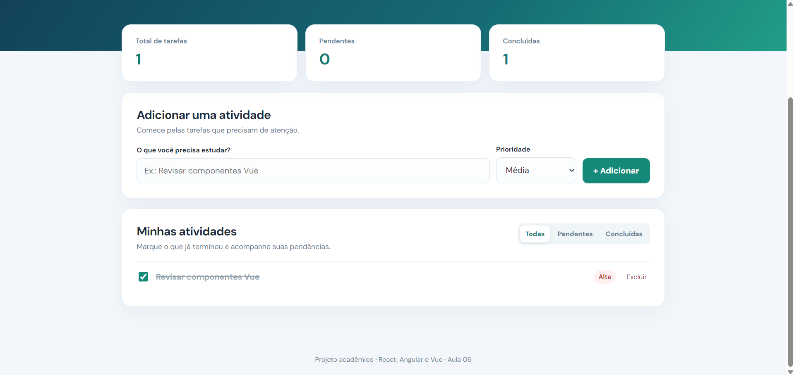

**7. Tarefa removida e contadores zerados**

### Validação manual do Angular — 24/11/2026

A estudante abriu [Mini Jogos em Angular](https://exercicioangular.vercel.app) e enviou uma captura real da página publicada. A imagem apresenta **Mini Jogos em Angular**, **Contador de Cliques** iniciado em **0**, **Rolar Dado** com valor inicial visível **1** e o título **Adivinhe o Número** na parte inferior da tela.

**Resultado:** abertura e renderização inicial da página confirmadas visualmente.

**Teste 2 — Incrementar contador:** após a estudante clicar três vezes no botão `+`, a captura mostrou o contador alterado de **0** para **3**, confirmando o funcionamento da operação de incremento. A captura está anexada ao GitHub.

**Teste 3 — Decrementar contador:** após um clique no botão `−`, a captura mostrou a redução do contador de **3** para **2**, confirmando o decremento. A captura está anexada ao GitHub.

**Teste 4 — Reset do contador:** após clicar no botão **Reset**, a captura da interface mostrou o contador novamente em **0**, conforme o comportamento esperado. A captura está anexada ao GitHub.

**Teste 5 — Rolar dado:** após a sequência de cliques solicitada, a captura enviada mostra o dado com valor **6**, diferente do valor **1** observado na captura inicial. O resultado está dentro da faixa de **1 a 6** prevista na implementação. A imagem comprova o valor final apresentado; os resultados individuais de cada clique não foram registrados. A captura está anexada à pasta `prints/`.

**Teste 6 — Adivinhe o Número (primeiro palpite):** após inserir **25** e clicar em **Tentar**, a interface mostrou a mensagem **“Tente um número menor!”** e atualizou o indicador para **Tentativas: 1**. O resultado confirma o processamento do primeiro palpite e a orientação para um valor inferior a 25. As demais condições do jogo ainda precisam ser testadas.

**Teste 7 — Segundo palpite:** a estudante informou **12** e a tela exibiu novamente **“Tente um número menor!”**, com **Tentativas: 2**. O jogo processou o palpite, manteve a orientação e incrementou corretamente o contador. Como ambos os palpites foram altos, o número secreto está abaixo de **12**. A vitória ainda não foi testada.

**Teste 8 — Terceiro palpite:** ao informar **6**, a captura exibiu novamente **“Tente um número menor!”** e **Tentativas: 3**, confirmando que o palpite foi processado e o contador incrementado. O número secreto, nessa rodada, ficou restrito a **1–5**; a vitória ainda não foi verificada. A imagem está anexada ao GitHub.

**Teste 9 — Quarto palpite:** ao informar **3**, a captura mostrou **“Tente um número maior!”** e **Tentativas: 4**. Com a orientação anterior de que o número era menor que 6, o valor secreto nessa rodada ficou restrito a **4 ou 5**. A vitória ainda não foi comprovada, e o print está anexado ao GitHub.

**Teste 10 — Quinto palpite:** ao informar **4**, a captura mostrou **“Tente um número maior!”** e **Tentativas: 5**. Considerando que a rodada já havia indicado um número **menor que 6**, restou **5** como único valor possível. A vitória ainda depende do próximo palpite e a imagem está anexada ao GitHub.

**Teste 11 — Vitória no jogo de adivinhação:** após informar **5**, a captura mostrou a mensagem **“Acertou! O número era 5. Tentativas: 6”** e o botão **Jogar Novamente**. O teste confirmou a identificação do número correto e a contagem de seis palpites. A imagem está anexada ao GitHub.

**Teste 12 — Reinício da partida:** após clicar em **Jogar Novamente**, a imagem mostra novamente o formulário de palpite, a mensagem inicial **“Tente adivinhar um número entre 1 e 50!”** e o indicador **Tentativas: 0**. O reinício visual e a zeragem do contador foram confirmados; o novo número secreto não foi testado. O print está anexado ao GitHub.

As 12 capturas reais do Angular foram anexadas à pasta [prints](prints/) do GitHub e estão disponíveis abaixo.

### Galeria das evidências do Angular

**Página inicial do Angular**

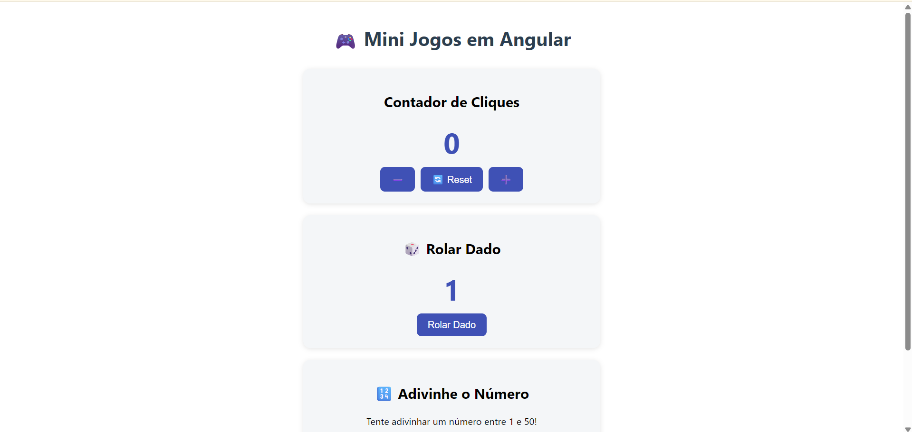

**Contador incrementado para 3**

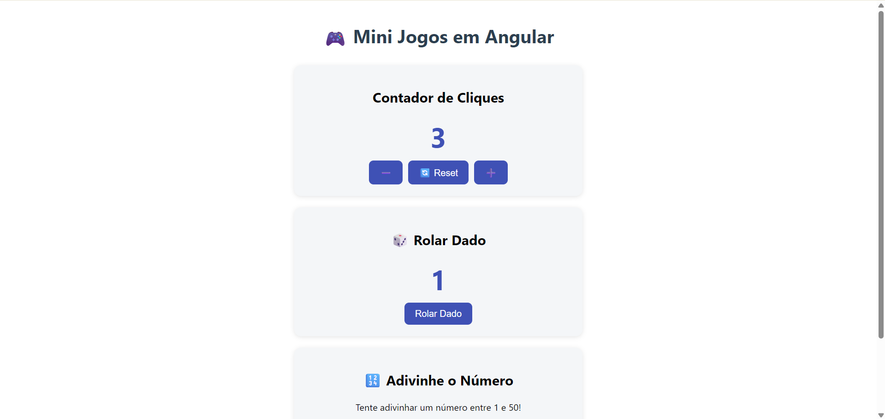

**Contador reduzido para 2**

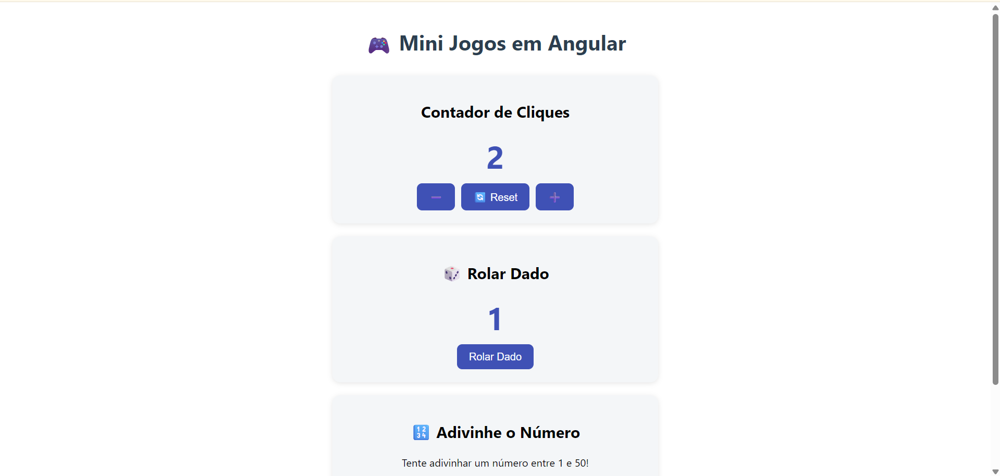

**Contador zerado pelo Reset**

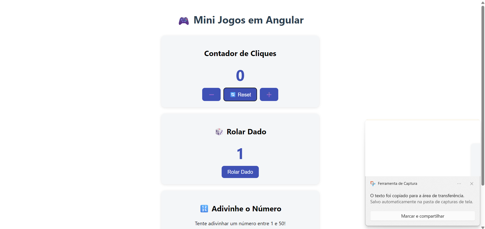

**Dado exibindo o valor 6**

**Primeiro palpite: 25**

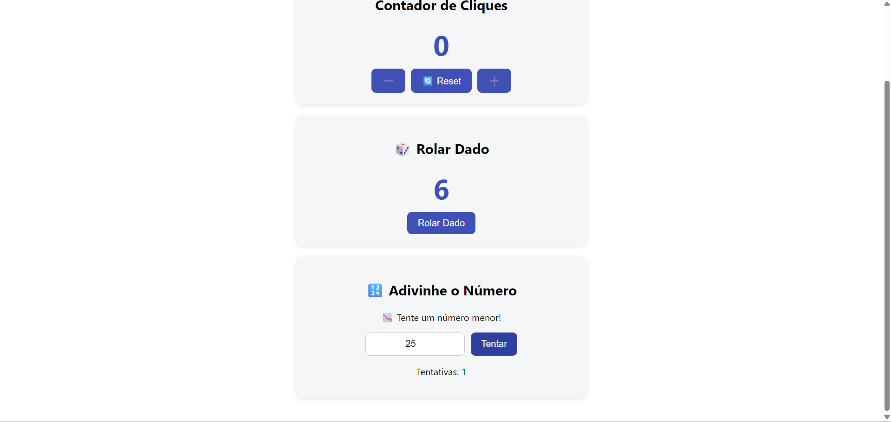

**Segundo palpite: 12**

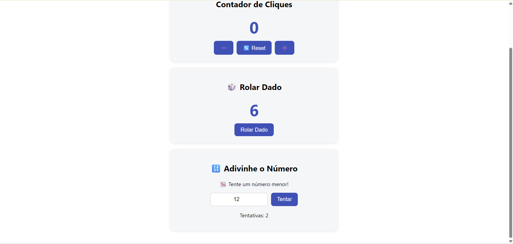

**Terceiro palpite: 6**

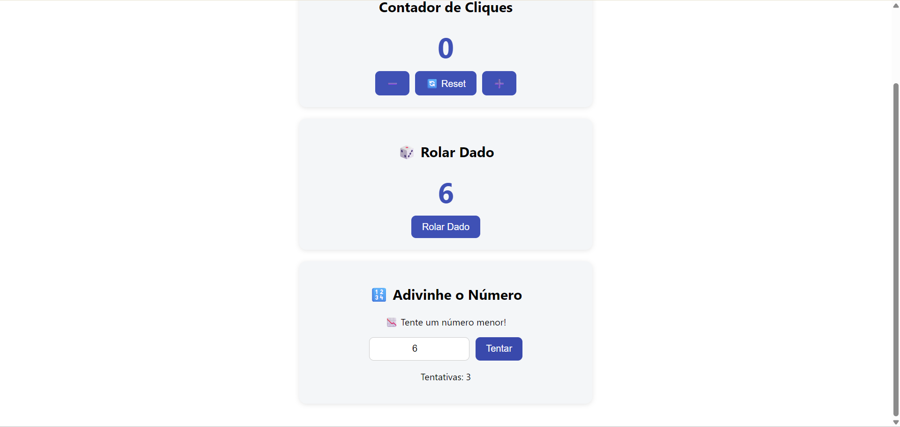

**Quarto palpite: 3**

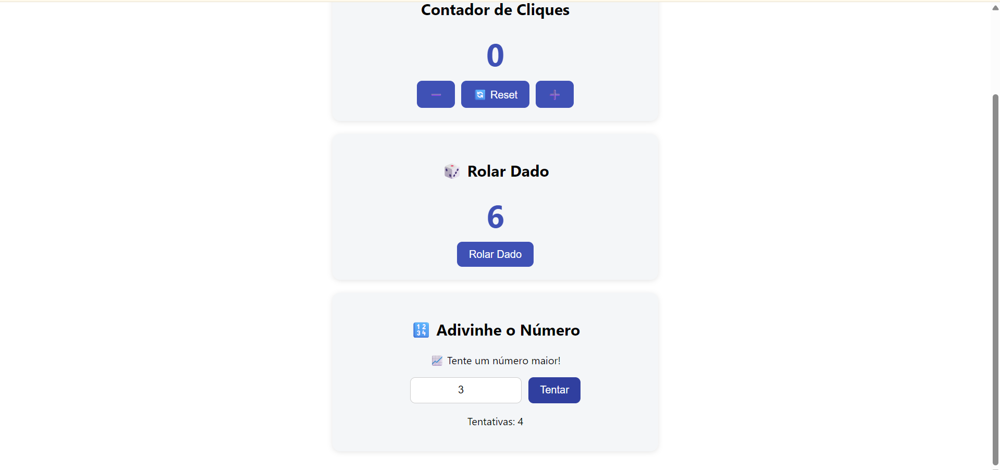

**Quinto palpite: 4**

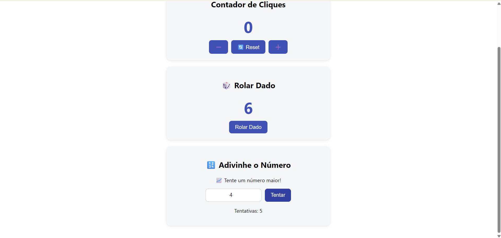

**Vitória no sexto palpite: 5**

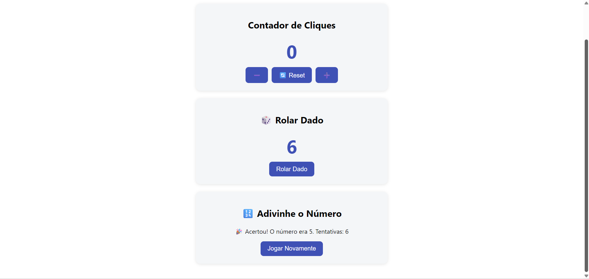

**Partida reiniciada com zero tentativas**

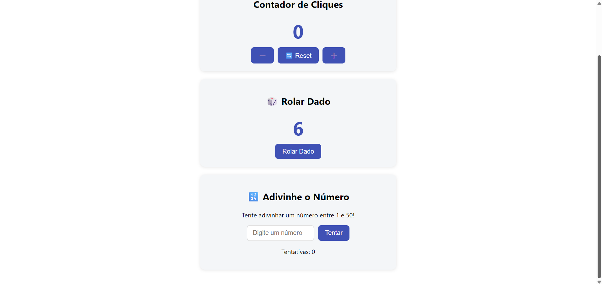

### Validação manual da HoennDex — 24/11/2026

**Teste 1 — Abertura da página:** a estudante abriu [HoennDex na Vercel](https://vue-project-alpha-peach.vercel.app) e enviou uma captura da página inicial. Estão visíveis o cabeçalho **HOENNDex**, os links **Início**, **Pokédex** e **Sobre Hoenn**, o título **Explore a região de Hoenn**, uma imagem de Rayquaza, o botão **Explorar Pokédex** e o início da seção do catálogo.

**Resultado:** abertura e renderização inicial da página confirmadas visualmente. A captura foi compartilhada nesta conversa, mas ainda não foi anexada à pasta `prints/` no GitHub.

**Teste 2 — Explorar Pokédex:** após clicar no botão **Explorar Pokédex**, a estudante apresentou a seção **Pokémon de Hoenn**. A imagem mostra o campo de pesquisa, o seletor de tipos em **Todos** e os cartões de **Treecko (#252)**, **Grovyle (#253)**, **Sceptile (#254)** e **Torchic (#255)** com imagens, nomes, tipos e atributos **HP, ATK e DEF**. A navegação até o catálogo e a renderização dos cartões foram confirmadas visualmente. O print permanece nesta conversa, sem upload ao GitHub.

**Teste 3 — Pesquisa por nome:** com o termo **Torchic** digitado no campo de busca e o filtro de tipo em **Todos**, a captura mostrou somente o cartão **Torchic (#255)**, com imagem, tipo **Fogo** e atributos HP **45**, ATK **60** e DEF **40**. Os demais Pokémon deixaram de aparecer, confirmando visualmente o filtro por nome. A captura está nesta conversa e ainda precisa ser anexada ao GitHub.

**Teste 4 — Filtro por tipo Fogo:** depois de limpar a busca e selecionar **Fogo** no menu, a captura exibiu apenas **Torchic (#255)**, **Combusken (#256)** e **Blaziken (#257)**, todos com Fogo entre seus tipos. Combusken e Blaziken também aparecem como **Lutador**. A filtragem por tipo e a exibição dos cartões foram confirmadas visualmente. O print foi enviado nesta conversa, mas ainda não foi anexado ao repositório. A navegação até a seção **Sobre Hoenn** foi testada a seguir; o comportamento responsivo permanece pendente.

**Teste 5 — Navegação para Sobre Hoenn:** após selecionar **Sobre Hoenn** no menu superior, a captura mostrou a seção **Região de Hoenn**, o título **“Uma nova geração de aventuras”**, o texto de apresentação da terceira geração, o destaque **“135 Novos Pokémon”** e o rodapé **“HoennDex — Projeto desenvolvido em Vue.js”**. A navegação e a renderização dessa seção foram confirmadas visualmente. A captura foi recebida nesta conversa, mas ainda precisa ser anexada à pasta `prints/`.

**Teste 6 — Visualização móvel (etapa inicial):** a estudante ativou o modo responsivo do Chrome e ajustou a largura para **390 px**; a captura mostra o título e o texto da apresentação reorganizados em linhas menores e o cabeçalho visível sem corte horizontal aparente nessa região. A altura estava definida como **390 px**, por isso parte do botão de navegação ficou fora da área visível verticalmente. Essa captura confirma apenas a adaptação inicial da seção de abertura, e ainda não comprova o comportamento de toda a página, dos filtros ou da navegação em dispositivo móvel. O print permanece nesta conversa e não foi anexado à pasta `prints/`.

**Teste 7 — Visualização móvel em 390 × 844 px:** a estudante ajustou a simulação do Chrome para **390 px de largura** e **844 px de altura**. A captura mostra o cabeçalho, o título **Explore a região de Hoenn**, o texto explicativo, o botão **Explorar Pokédex** e a ilustração do Rayquaza reorganizados verticalmente, sem corte horizontal aparente na seção inicial. A barra de navegação desktop não aparece nesse tamanho, conforme as regras responsivas identificadas no CSS. **Resultado:** apresentação inicial validada visualmente nessa dimensão. O print está nesta conversa e ainda não foi anexado ao GitHub.

**Teste 8 — Catálogo no celular em 390 × 844 px:** após selecionar a seção da Pokédex, a captura mostra o título **Pokémon de Hoenn**, o campo **Pesquisar Pokémon...**, o seletor de tipo **Fogo** abaixo da pesquisa e o cartão de **Torchic (#255)** ajustado à largura da simulação. A imagem e os dados visíveis do cartão aparecem organizados verticalmente, sem corte horizontal aparente. O teste confirma a **apresentação visual** do catálogo e do filtro previamente selecionado nessa largura; não comprova uma nova interação com o filtro em modo móvel nem a visualização dos outros cartões abaixo da dobra. Esta evidência foi enviada na conversa e ainda precisa ser anexada ao GitHub.

## 10. Situação da atividade

- [x] Código do projeto Angular analisado e documentado.
- [x] Código do projeto HoennDex em Vue analisado e documentado.
- [x] Projeto React da Aula 05 localizado.
- [ ] Confirmar o projeto React correspondente à Aula 06.
- [x] Criar implementação básica em Vue no repositório anteriormente vazio (complementação em 24/11/2026).
- [ ] Identificar o template original e registrar as modificações.
- [ ] Executar e testar os projetos no navegador.
- [x] Identificar e registrar os quatro deploys no painel da Vercel (`READY`).
- [x] Conferir abertura, cadastro e conclusão de tarefas no Vue básico por capturas da versão publicada.
- [x] Validar visualmente os filtros e a persistência após atualização do Vue básico, por capturas enviadas pela estudante.
- [x] Validar exclusão de tarefa no Vue básico com print de lista vazia e contadores zerados.
- [ ] Testar funcionamento e acesso público das demais interfaces.
- [x] Anexar ao GitHub as sete capturas reais de validação do Vue básico.
- [x] Anexar os 12 prints reais dos testes do Angular.
- [ ] Adicionar os prints de React, HoennDex e dos demais requisitos da aula.

## 11. Conclusão

A consulta aos projetos existentes demonstrou o uso de diferentes tecnologias para construir interfaces: React para aplicações baseadas em estado, Angular com componentes e formulários, e Vue com reatividade e filtros calculados.

A documentação aproveita os trabalhos já disponíveis. Ela não declara como concluídos os itens cuja execução, importação ou publicação não foi confirmada.
