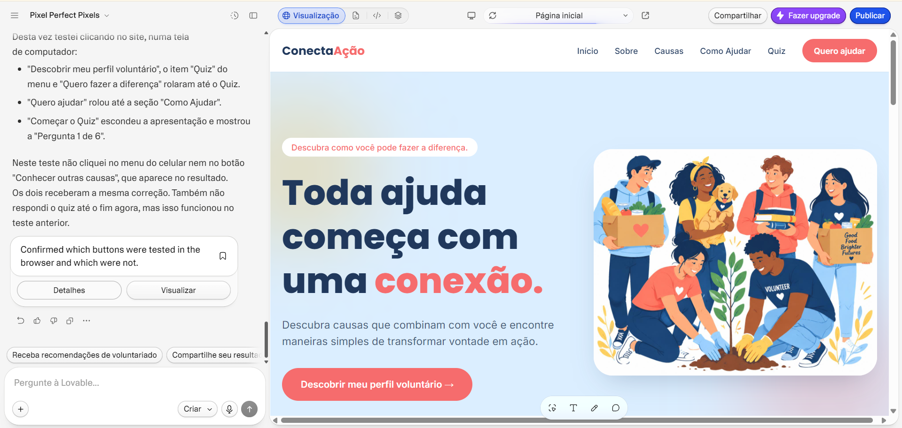
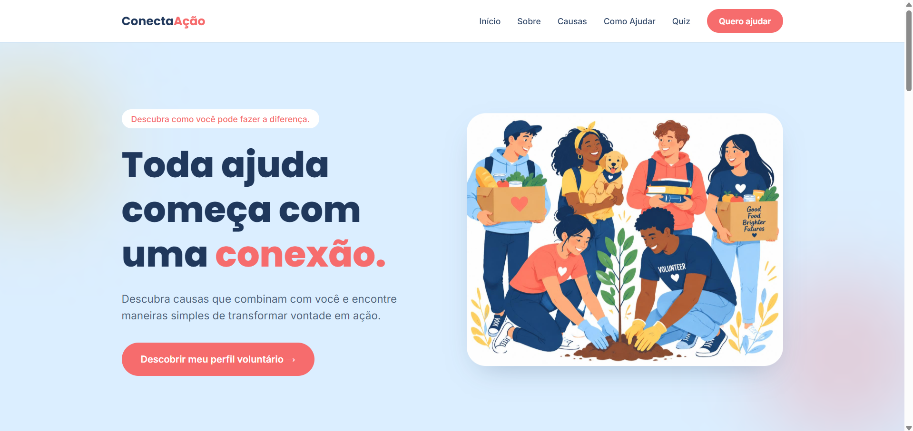
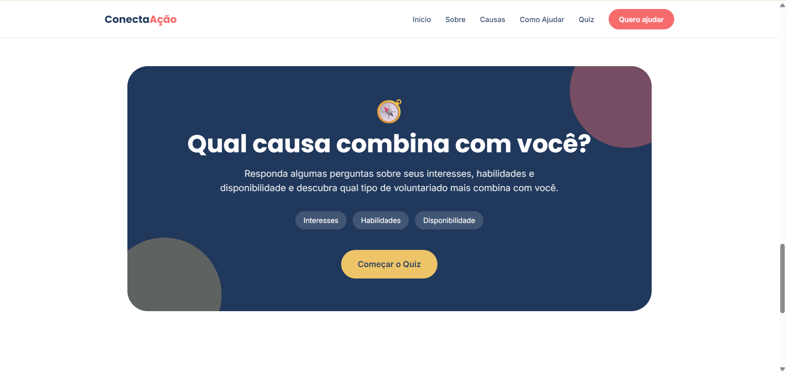
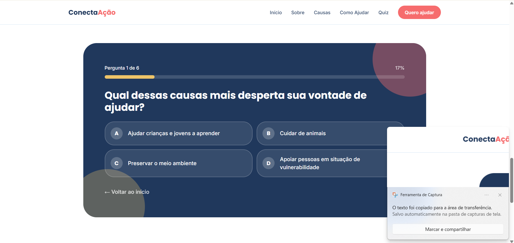
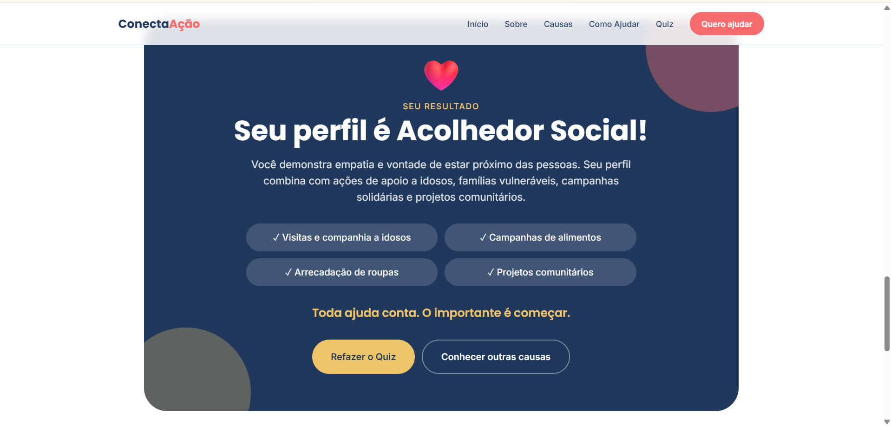
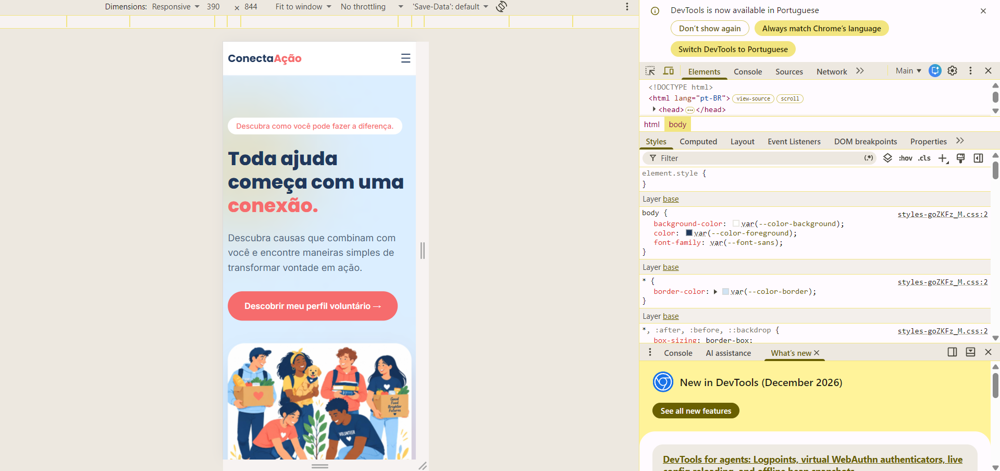

# Atividade 09 — Website Builder com IA: ConectaAção

**Disciplina:** Programação Web  
**Professor:** Prof. Me. Deivison S. Takatu  
**Instituição:** Fatec Itapetininga

## 1. Objetivo

Utilizar uma ferramenta de criação de sites com recursos de inteligência artificial para produzir uma página personalizada, adicionar conteúdo, implementar ao menos uma interação e avaliar o resultado em diferentes tamanhos de tela.

## 2. Projeto identificado

**Nome mostrado no código:** ConectaAção  
**Ferramenta declarada:** Lovable  
**Repositório:** [pixel-perfect-pixels](https://github.com/Luizaaaaaah/pixel-perfect-pixels) — **privado**  
**Editor:** [Projeto no Lovable](https://lovable.dev/projects/827f8a9a-8919-4bbf-aa28-04b64bd48edd) — pode exigir autenticação.

O README do projeto afirma que ele foi criado com Lovable e que as alterações feitas no editor são sincronizadas com o repositório GitHub.

A finalidade do **ConectaAção** é apresentar diferentes causas de voluntariado e incentivar o visitante a encontrar formas de ajudar sua comunidade.

O projeto é compatível com os requisitos técnicos da Aula 09, embora seu vínculo como entrega final da disciplina ainda dependa de confirmação.

## 3. Estrutura da página

O arquivo principal [src/routes/index.tsx](https://github.com/Luizaaaaaah/pixel-perfect-pixels/blob/main/src/routes/index.tsx) contém:

| Seção | Conteúdo identificado |
|---|---|
| Início | Apresentação do projeto e botão para descobrir o perfil voluntário |
| Sobre | Explicação da proposta de incentivo ao voluntariado |
| Causas | Cartões com áreas de atuação voluntária |
| Como Ajudar | Exemplos de contribuições por tempo, habilidades, doações e divulgação |
| Quiz | Questionário interativo para identificar afinidade com causas |
| Rodapé | Identidade do projeto e navegação |

As causas apresentadas incluem educação, proteção animal, meio ambiente, apoio social a idosos, combate à fome e voluntariado digital.

## 4. Personalização visual

O código apresenta identidade visual própria:

- Cores semânticas **coral**, **amarelo-sol**, **azul-claro** e **azul-escuro**;
- Uso das fontes **Poppins** (destaques) e **Inter** (texto);
- Seções com espaçamento amplo e cartões arredondados;
- Imagem de destaque na área inicial;
- Botões de chamada para ação;
- Transições e movimentos leves em elementos visuais.

Essas escolhas estão declaradas no arquivo **src/styles.css**, que utiliza Tailwind CSS, variáveis de tema e estilos associados à interface.

## 5. Funcionalidade interativa — Quiz de voluntariado

O arquivo [src/components/Quiz.tsx](https://github.com/Luizaaaaaah/pixel-perfect-pixels/blob/main/src/components/Quiz.tsx) implementa um questionário com **seis perguntas**.

### Fluxo previsto

1. O usuário seleciona **Começar o Quiz**.
2. Responde seis perguntas com alternativas.
3. Visualiza o progresso e pode retornar à pergunta anterior.
4. As respostas contribuem para categorias de interesse.
5. Ao final, o sistema calcula um perfil e apresenta uma descrição e sugestões de ações.
6. O usuário pode refazer o quiz ou conhecer outras causas.

### Perfis previstos

| Perfil | Exemplos de ações exibidas |
|---|---|
| Educador Social | Reforço escolar e oficinas |
| Protetor Animal | Apoio a abrigos e campanhas de adoção |
| Agente Ambiental | Plantio, limpeza e reciclagem |
| Acolhedor Social | Apoio a idosos e campanhas solidárias |
| Voluntário Digital | Design, tecnologia e divulgação para organizações |

O cálculo contabiliza pontos atribuídos às alternativas e utiliza critérios de desempate definidos no código. As sugestões são orientativas, não avaliações profissionais.

## 6. Tecnologias observadas

O projeto inclui **React**, **TypeScript**, **TanStack Router**, **Tailwind CSS**, **Vite** e bibliotecas de interface definidas no **package.json**. O uso do Lovable como ferramenta de criação é declarado no README.

### Responsividade prevista no código

A interface utiliza classes responsivas como **md:**, **sm:** e **lg:** para alterar grades, espaçamentos, tipografia e navegação. Em telas menores, o cabeçalho prevê um botão que abre e fecha o menu mobile.

A presença dessas regras indica preocupação com responsividade. A estudante apresentou um print real da página inicial em **390 × 844 px**, mostrando a adaptação do texto, da imagem e o ícone do menu móvel. O menu não foi aberto no teste apresentado, e os demais componentes no celular ainda não foram verificados.

## 7. Como executar localmente

Com Node.js e NPM instalados:

~~~bash
npm install
npm run dev
~~~

O projeto também possui scripts para build e testes. Esta documentação foi elaborada por inspeção do código, sem afirmar que os comandos foram executados.

## 8. Acesso e publicação

| Recurso | Situação |
|---|---|
| Repositório de código | [pixel-perfect-pixels](https://github.com/Luizaaaaaah/pixel-perfect-pixels) — privado |
| Projeto no editor Lovable | [Abrir editor](https://lovable.dev/projects/827f8a9a-8919-4bbf-aa28-04b64bd48edd) — acesso pode exigir login |
| Página principal | Identificada no código como ConectaAção |
| Quiz de seis perguntas | Implementação localizada |
| Deploy Vercel | [pixel-perfect-pixels-orcin.vercel.app](https://pixel-perfect-pixels-orcin.vercel.app) — deploy de produção `READY` no painel e página inicial aberta visualmente pela estudante; acesso por terceiros ainda a validar |
| Testes de responsividade | Página inicial conferida em simulação de celular 390 × 844 px; demais seções ainda não verificadas |

**Importante:** o professor não conseguirá acessar o conteúdo de um repositório privado sem receber permissão. A alternativa é disponibilizar acesso autorizado ou uma publicação pública da aplicação. Nenhuma alteração de privacidade foi realizada.

## 9. Evidências a anexar

Usar capturas reais na pasta [prints](prints/README.md):

| Nome | Conteúdo |
|---|---|
| 01-projeto-lovable.png | Projeto aberto no editor Lovable |
| 02-identidade-visual.png | Estilos e personalização |
| 03-homepage.png | Página inicial ConectaAção |
| 04-quiz-pergunta.png | Pergunta do quiz |
| 05-quiz-resultado.png | Perfil calculado |
| 06-responsividade-mobile.png | Visualização em celular |
| 07-site-publicado.png | Print complementar da URL pública, se solicitado |
| 08-quiz-apresentacao.png | Tela inicial do quiz e botão para começar |

Não incluir dados de acesso nas capturas.

## Validação visual da versão publicada

**Teste 1 — Página inicial:** a estudante abriu [ConectaAção publicado na Vercel](https://pixel-perfect-pixels-orcin.vercel.app/) e forneceu uma captura real da página inicial. Estão visíveis o logotipo **ConectaAção**, o menu **Início, Sobre, Causas, Como Ajudar e Quiz**, o botão **Quero ajudar**, a frase **“Toda ajuda começa com uma conexão.”**, a ilustração de voluntariado e o botão **Descobrir meu perfil voluntário**.

**Resultado:** a abertura da página, o carregamento da imagem e a apresentação do menu e da seção inicial foram confirmados visualmente na navegação da estudante. O acesso por outra pessoa, sem sessão autenticada, ainda requer verificação independente.

**Teste 2 — Abertura do quiz:** a captura mostra a seção **“Qual causa combina com você?”**, com explicação do questionário e botão **Começar o Quiz**. A abertura visual foi confirmada.

**Teste 3 — Pergunta do quiz:** após iniciar, a tela mostra **“Pergunta 1 de 6”**, indicador de progresso de **17%** e a pergunta **“Qual dessas causas mais desperta sua vontade de ajudar?”**, com quatro opções visíveis. O primeiro passo do formulário foi confirmado por print; as respostas intermediárias não foram capturadas uma a uma.

**Teste 4 — Resultado final do quiz:** a estudante completou o fluxo e enviou a tela **“Seu perfil é Acolhedor Social!”**, que descreve apoio a pessoas e apresenta sugestões como visitas a idosos, campanhas de alimentos, arrecadação de roupas e projetos comunitários. Os botões **Refazer o Quiz** e **Conhecer outras causas** aparecem no resultado. Isso confirma visualmente o avanço até um resultado; os botões finais não foram testados nesta rodada.

**Teste 5 — Responsividade da página inicial:** na simulação do Chrome com **390 × 844 px**, a página apresenta logotipo, ícone de menu móvel, texto de abertura, botão principal e imagem de voluntariado em organização vertical. Não há corte horizontal aparente na região mostrada. A abertura do menu móvel e o quiz em celular não foram testados.

**Teste 6 — Projeto no editor Lovable:** o print mostra a interface do editor **Pixel Perfect Pixels** e a prévia do **ConectaAção**. O editor foi acessado visualmente; esta captura não comprova, por si, histórico completo das alterações ou publicação original pelo editor.

**Evidências:** as seis imagens reais desta validação foram **confirmadas no GitHub** na pasta [prints](prints/) da branch `reorganizacao`.

### Galeria de evidências reais

**Editor Lovable e prévia do ConectaAção**

**Página inicial publicada**

**Apresentação do quiz**

**Pergunta 1 de 6**

**Resultado Acolhedor Social**

**Página inicial na resolução 390 × 844 px**

## 10. Situação da atividade

- [x] Repositório associado ao Lovable localizado.
- [x] Estrutura das seções identificada no código.
- [x] Identidade visual e tecnologias documentadas.
- [x] Quiz de seis perguntas e cinco perfis identificado.
- [ ] Confirmar que este foi o projeto entregue na Aula 09.
- [x] Confirmar visualmente o fluxo do quiz até um resultado e a página inicial responsiva em 390 × 844 px.
- [ ] Conferir interações adicionais do quiz e do menu móvel.
- [x] Confirmar deploy de produção `READY` e registrar domínio na Vercel.
- [x] Confirmar a abertura da página inicial publicada por captura real da estudante.
- [x] Validar o fluxo principal do quiz no navegador a partir dos prints da estudante.
- [ ] Verificar acesso sem login por outra pessoa.
- [ ] Garantir ao professor acesso à entrega.
- [x] Anexar seis prints reais da aplicação, do quiz, da versão móvel e do editor Lovable.

## 11. Conclusão

O **ConectaAção** exemplifica a utilização de um Website Builder com IA para produzir uma página temática personalizada e uma experiência interativa.

A análise do código mostra as seções planejadas, a identidade visual, a navegação e o questionário de voluntariado. Um deploy de produção foi localizado como `READY` no painel da Vercel, e a página inicial, o quiz até o resultado e o layout inicial para celular foram conferidos visualmente; as seis imagens estão anexadas; ainda é necessário garantir acesso adequado do professor e confirmar a entrega da atividade.
